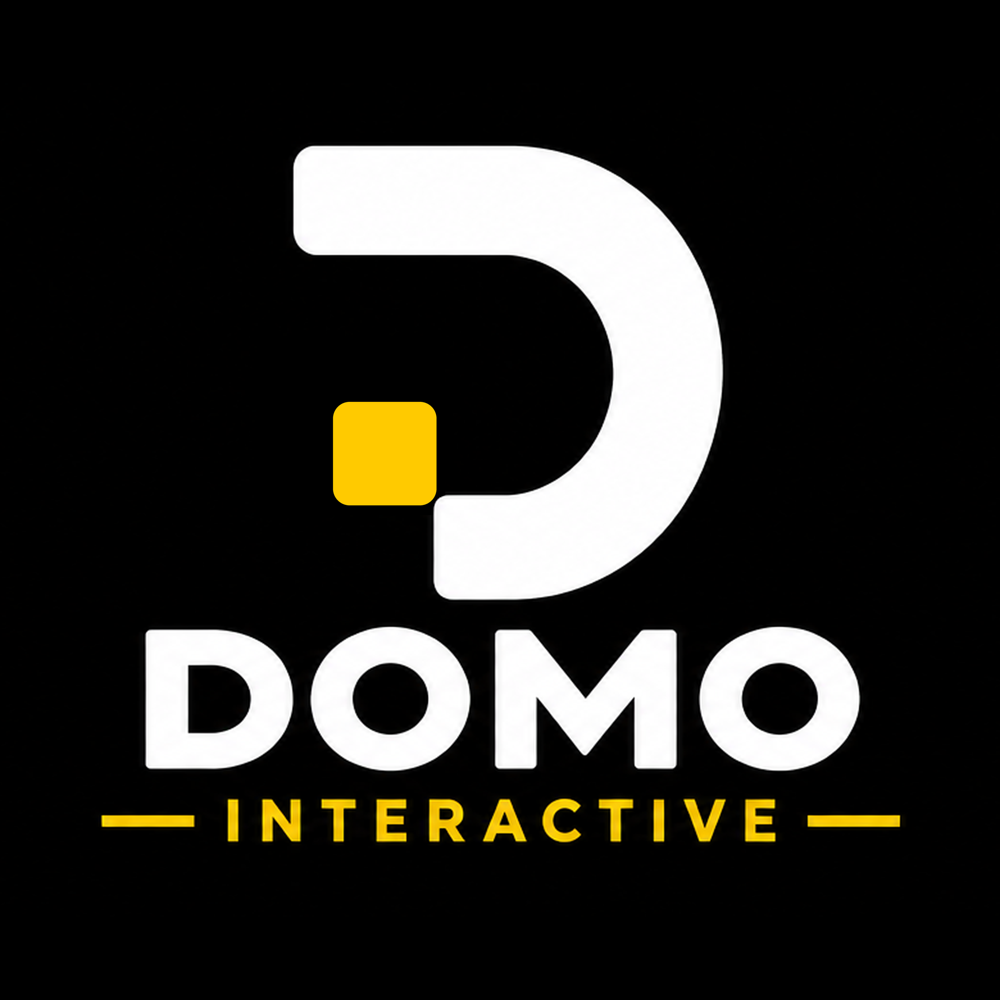

# OpenLuau Toolkit



Maintained by Domo Interactive.

Small, independently usable Luau modules for Roblox gameplay rules.

**Status: initial implementation, unreleased.** Four modules are implemented and checked with standalone Luau. There is no published package or tagged release. Roblox Studio integration, networking and persistent storage have not been tested or implemented.

## Available modules

| Module | Implemented behaviour | Documentation |
| --- | --- | --- |
| Inventory and equipment | Item definitions, bounded capacity, stack limits, add/remove/move, configurable equipment slots | [Inventory](packages/inventory/README.md) |
| Experience and progression | Configurable total-XP thresholds, level caps and level-up reward descriptions | [Progression](packages/progression/README.md) |
| Combat and damage | Health, shields, damage permission, flat reduction, multiplier, piercing and healing | [Combat](packages/combat/README.md) |
| Economy and shops | Integer wallets, balance limits, authoritative catalogues and consistent purchase results | [Economy](packages/economy/README.md) |

Each module is a single source file with no runtime dependencies or module initialisation side effects. Operations return new state; existing state remains unchanged. Results and configuration snapshots are frozen.

## Use the modules

Start with the [loading and state guide](docs/usage.md) and a module README. Copy the required source file into your Roblox project as a ModuleScript; the source modules contain no string-path requires or Roblox service calls. The guide shows the intended server-side loading pattern. That Studio integration has not been executed here.

For a working standalone integration, see [examples/basic.luau](examples/basic.luau). It equips an item, buys potions, awards experience and resolves damage. It requires the four modules using command-line relative paths; those example require lines must be replaced with ModuleScript references in Studio.

## Run the basic checks

Install Python 3, then from the repository root:

```sh
python3 scripts/bootstrap.py
python3 scripts/check.py
```

The installer downloads official Luau **0.748** binaries and verifies a pinned SHA-256 checksum. The check command runs strict static analysis, **22 behaviour tests** and the command-line example. Linux x86-64 execution is verified. The same commands are configured in [GitHub Actions](.github/workflows/check.yml).

These checks cover the rule modules and their composition. They do not establish Studio, multiplayer, persistence or production behaviour. See the [quality record](docs/quality.md).

## Boundaries

Keep authoritative state, item definitions, prices and permission decisions on the server. These modules validate operation values; they do not authenticate remote requests, detect hits, prevent request replay or save profiles. Progression returns reward descriptions; the game applies them when committing the new progression state.

The shop combines a wallet with an injected, pure inventory operation and returns both updated values. Commit them together in your server's profile. This is an in-memory state calculation, with no durable transaction guarantee.

Networking, persistent player data, quests, achievements and NPC/pathfinding systems remain [planned](ROADMAP.md). No interfaces, game-specific content or mandatory framework are included.

## Project documentation

- [Architecture](docs/architecture.md) and [module catalogue](docs/modules.md).
- [Development plan](docs/development.md) and [roadmap](ROADMAP.md).
- [Ecosystem research](docs/research/ecosystem.md).
- [Contribution guidelines](CONTRIBUTING.md), [security policy](SECURITY.md) and [changelog](CHANGELOG.md).

## Licence and commercial use

Original toolkit material is available under the [MIT licence](LICENSE), copyright Domo Interactive. Proprietary games can consume the toolkit in separate repositories while preserving required copyright and licence notices. Keep game-specific code, assets and player data outside this public repository. See [scope](docs/scope.md) and [third-party notices](THIRD_PARTY_NOTICES.md).

OpenLuau Toolkit is independent and is not affiliated with Roblox or the Luau language project.
